# MOP para Windows — versão 2.1.0

> **Versão atual: 2.1.0.** Para a apresentação, o objetivo de uso e a lista atualizada de recursos, consulte [README.md](README.md). A próxima versão 2.2.0 está em preparação; o README distingue alterações presentes no código de funcionalidades ainda pendentes. Este guia preserva as instruções técnicas detalhadas de uso, dados locais e recuperação.



**MOP — desenvolvido por NOXUZ**

Projeto Electron com a interface do MOP, SQLite local e backups JSON. O login de um operador autorizado é obrigatório antes de acessar qualquer informação. O primeiro login exige internet; após validá-lo, o último operador pode entrar offline com a senha por até 7 dias. Consulte [SUPABASE.md](SUPABASE.md) para configurar os usuários e a sincronização.


## Apresentação

O MOP (Monitoramento Operacional), desenvolvido por **NOXUZ**, é um aplicativo para Windows que reúne o livro de turno, registros operacionais, acompanhamento de pendências e passagem de turno. Cada computador mantém uma base local; a central compartilhada permite sincronizar os registros entre operadores autorizados.

## Instruções de uso

1. Instale e abra o MOP. No primeiro acesso, conecte-se à internet e entre com a conta autorizada pelo administrador. A criação de contas e a autorização estão descritas em [SUPABASE.md](SUPABASE.md).
2. Em **Início**, consulte o resumo do turno, as pendências e os prazos.
3. Em **Novo registro**, preencha os campos obrigatórios e salve a ocorrência.
4. Em **Registros**, busque ocorrências, acompanhe o histórico e atualize o andamento.
5. Em **Passagem de turno**, confira os itens abertos, informe os operadores e confirme o recebimento. A mudança de horário não confirma o recebimento automaticamente.
6. Em **Ferramentas → Calendário**, consulte registros e passagens por data. Em **Ferramentas → Sobre**, consulte a versão, a identificação da NOXUZ e o guia rápido.
7. Abra o submenu **Dados** para **Importar dados** ou **Exportar dados**. A importação substitui a base e exige confirmação; quando a base está vinculada à central, essa substituição fica bloqueada.
8. Use **Salvar backup** para guardar uma cópia JSON e **Abrir pasta de dados** para localizar os arquivos locais.
9. Em **Sincronização**, confira o envio das alterações e revise conflitos quando necessário. Use **Sair do MOP** ao terminar.

O último operador validado online pode acessar este computador offline, com a mesma senha, por até **7 dias**. Depois desse prazo, é necessário renovar o login online.

## Executável sem instalação

A versão `MOP-Executavel-2.1.0.exe` contém o aplicativo e seu runtime. Abra no Windows 10/11 de 64 bits. Os dados continuam em `%APPDATA%\MOP\dados`, não dentro do executável; copiar somente o EXE para outro computador não leva os registros. Os registros sincronizados são obtidos pela central após o login. Para restauração local em uma base não vinculada, use Dados → Exportar dados / Importar dados. Para gerar esta versão novamente, execute `GERAR-EXECUTAVEL.cmd` ou `npm run dist:portable`.

## Gerar o instalador no Windows

1. Exporte seus registros no MOP HTML atual e guarde o JSON.
2. Instale Node.js 24 LTS pelo site https://nodejs.org/ no computador de desenvolvimento, com internet. Feche e reabra o terminal após instalar.
3. Extraia este ZIP para uma pasta permanente, por exemplo Documentos\MOP-Windows. Não execute dentro do ZIP.
4. Execute `GERAR-INSTALADOR.cmd`. O script instala as dependências, executa os testes e gera `dist\MOP-Instalador-2.1.0.exe`.
5. Instale o MOP no Windows 10/11 de 64 bits e abra pelo atalho. Se precisar restaurar uma base local ainda não vinculada à central, abra Dados → Importar dados, escolha o JSON e confirme a substituição.

O download das ferramentas na primeira geração precisa de internet. O instalador pronto inclui o runtime: o computador que usará o MOP não precisa de Node.js ou VS Code. O login inicial e a sincronização exigem internet; o uso offline depende de um login autorizado recente. Políticas da empresa ainda podem exigir liberação do aplicativo pela TI. O pacote não possui certificado de assinatura digital.

## Editar no VS Code

Abra esta pasta em Arquivo → Abrir Pasta. No terminal:

```sh
npm ci
npm start
```

Após alterações, feche e reabra o aplicativo. Para testar e gerar novamente:

```sh
npm test
npm run dist:win
```

- `src/index.html`: estrutura da interface.
- `src/style.css`: aparência.
- `src/app.js`: registros, histórico, turno, calendário e importação.
- `desktop/main.cjs`: janela, diálogos, isolamento e integração local.
- `desktop/preload.cjs`: ponte restrita entre interface e banco.
- `desktop/store.cjs`: SQLite, transações e backups.
- `assets/`: logotipo e ícone do aplicativo.

## Dados e backups

Os dados ficam em `%APPDATA%\MOP\dados\mop.sqlite`, fora da pasta de instalação. Cada usuário do Windows tem sua própria base. A atualização do aplicativo não deve apagar essa pasta.

O SQLite armazena o estado completo em uma transação, incluindo registros, eventos, protocolos, turnos e contadores. A interface não usa mais localStorage. A base local tem limite de 64 MB por estado. O compartilhamento entre computadores é feito pela sincronização com a central, e não pelo acesso direto ao arquivo SQLite.

Antes de cada alteração/importação, o programa salva o estado anterior em `dados\backups`. Também cria uma cópia ao iniciar e mantém as 30 mais recentes. Se o backup falhar, a alteração é cancelada e aparece uma mensagem. Use **Salvar backup** para guardar uma cópia atual em outra unidade ou pasta autorizada. Os backups na mesma unidade não protegem contra defeito/perda do disco.

Para restaurar um JSON: abra **Dados → Importar dados**, confira os totais e confirme. A importação substitui a base atual; não mescla bases de computadores diferentes. Os registros do antigo HTML não são importados automaticamente.

Se o banco estiver danificado e o aplicativo não abrir: feche o MOP, copie toda a pasta `dados` para preservação, renomeie a pasta original para `dados-preservados` e reabra. O aplicativo criará uma base vazia. Importe um JSON de `dados-preservados\backups`. Não apague a pasta preservada.

Não mova um SQLite em uso para pasta de rede, OneDrive ou compartilhamento. Para dados unificados entre computadores, configure a central conforme SUPABASE.md. O aplicativo exige autenticação, mas o SQLite e os backups JSON não são criptografados; proteja a conta do Windows e a pasta dos dados. As novas operações têm autoria vinculada à conta autenticada; registros legados preservam os nomes já armazenados.

## Validação antes do uso operacional

Antes de distribuir uma nova versão, execute `npm test` e valide no Windows: login, criação e atualização de registros, passagem de turno, calendário, navegação em Sobre, exportação/importação, sincronização e reabertura preservando os dados. Confira a marca NOXUZ na abertura e na área Sobre. Use registros de teste. Gerar o instalador não substitui a validação no computador de destino.

Documentação técnica: https://www.electronjs.org/docs/latest/tutorial/security e https://www.electron.build/nsis/.

## Turno automático

O topo mostra o turno atual, a data de início, o horário de São Paulo e o tempo restante. Diurno: 06h até 17h59; noturno: 18h até 05h59, vinculado à data de início. A indicação é recalculada a cada segundo, ao voltar para a janela e ao retomar o Windows após suspensão.

A troca automática não confirma a passagem: “Troca de turno pendente” permanece até um recebimento manual no turno atual. Confirmações antigas são reconhecidas pelo horário registrado. Cada nova ação guarda o turno do instante de gravação: created_shift/updated_shift nos registros e shift no histórico e nas passagens. Dados antigos permanecem intactos; o turno pode ser consultado a partir do horário original. Exportação e importação JSON preservam os campos adicionais e continuam aceitando backups antigos.
# Sincronização entre computadores

A configuração do Supabase está documentada em [SUPABASE.md](SUPABASE.md). Cada computador mantém seu banco local e uma fila de alterações para trabalhar offline. Configure as tabelas e os operadores antes de entrar pela tela de login obrigatório. A primeira conexão pede confirmação para enviar os registros locais. Sem um login autorizado, a interface e os comandos de dados ficam bloqueados.
