# MOP — Monitoramento Operacional



**Aplicativo de livro de turno, ocorrências e continuidade operacional para Windows.** Desenvolvido por **NOXUZ**.

> **Versão atual: 2.2.2.** Esta é a versão mais recente do repositório privado de desenvolvimento. O canal público de distribuição permanece em [MOP-Releases](https://github.com/NOXUZ-CySec/MOP-Releases/releases). O portal web/mobile ainda não está liberado.

Este é o repositório **privado de desenvolvimento** do MOP. Ele concentra o código-fonte, testes, migrações, documentação e fluxo de build. Os instaladores destinados a testadores e usuários são publicados separadamente no repositório público de releases.

O MOP reúne registros operacionais, pendências, checklists, alertas, anexos, relatórios, indicadores e passagem de turno em uma única aplicação, com sincronização entre estações autorizadas e operação offline controlada.

## Versão 2.2.2

A versão **2.2.2** consolida as correções de patch aplicadas desde a 2.2.1 e reformula o fluxo operacional de passagem de turno.

Principais mudanças:

- Passagem de turno dividida em **entrega** e **recebimento**, sem campos manuais redundantes de autoria.
- Operador que encerra o turno registra apenas o resumo necessário para continuidade; o próximo operador recebe a passagem em etapa separada.
- Ciência de pendências críticas exigida somente no recebimento.
- Sincronização permite complementar uma entrega pendente com o recebimento, mantendo a passagem imutável depois de concluída.
- Tutorial guiado no primeiro login, com opção de pular, refazer pela aba **Sobre** e conteúdo adaptado ao perfil do usuário.
- Tutorial redesenhado para não escurecer a aplicação inteira e manter visível o conteúdo que está sendo explicado.
- Correções de autoria confiável e consistência de testes operacionais.

A versão foi validada com **45/45 testes automatizados aprovados** e `MANAGEMENT_UI_OK`.

## Versão 2.2.1

A versão **2.2.1** corrige o travamento da interface ao marcar registros como **Resolvido** pelo seletor rápido de status. A confirmação passou a usar um modal próprio do MOP, eliminando o bloqueio de foco/cliques observado no Electron.

A correção foi validada com a suíte automatizada e teste de interface de gestão, mantendo a operação disponível após resolver registros.

## Principais recursos atuais

### Central operacional

- Painel do turno com abertos, urgentes, aguardando resposta/manutenção, prazos e destaques.
- Cadastro de registros com protocolo, condomínio, categoria, assunto, descrição, prioridade, origem, empresa, referência e prazo.
- Atualização por histórico, ação realizada e próxima ação, com autoria da conta autenticada.
- Alteração rápida de status por dropdown com confirmação própria do MOP para **Resolvido**.
- Correção de registros resolvidos sem apagar a resolução original.
- Calendário de registros e passagens.
- Anexos PNG/JPEG/PDF vinculados a registros.

### Turnos, autenticação e acessos

- Tela **Novidades do MOP** após o login para versões ainda não lidas.
- Login por **usuário ou e-mail + senha**; o e-mail continua sendo a identidade de autenticação no Supabase.
- Recebimento obrigatório do turno antes de liberar ações operacionais.
- Ciência das pendências críticas e registro auditável de quem assumiu o turno.
- Indicador permanente do turno assumido.
- Perfis `admin`, `supervisor`, `operator` e `viewer`, com escopo por condomínio.
- Administração de username, nome de exibição, perfil e condomínios em **Acessos**.

### Gestão e continuidade

- Checklists e rotinas configuráveis por frequência.
- Alertas de urgência, vencimento e atraso.
- Relatórios PDF, Excel e CSV.
- Indicadores operacionais por período, condomínio e categoria.
- Sincronização multiestação via Supabase com fila offline e revisão de conflitos.
- SQLite local e backups automáticos; backup manual restrito a perfis autorizados.
- Importação/exportação destrutiva da base operacional não faz parte da interface sincronizada atual.

## Atualização automática

A atualização automática foi introduzida na **2.1.1**. O cliente consulta o canal `NOXUZ-CySec/MOP-Releases`, detecta uma versão superior, baixa o instalador e o `.blockmap` e oferece reinicialização para instalação.

A **2.2.2** é a release atual do canal de testes e consolida as correções de patch posteriores à 2.2.1, incluindo o novo fluxo de passagem de turno e o tutorial guiado por perfil.

Os artefatos oficiais de uma release Windows são:

- `MOP-Instalador-<versão>.exe`
- `MOP-Instalador-<versão>.exe.blockmap`
- `latest.yml`

Não substitua apenas o executável de uma release sem atualizar também o `.blockmap` e o `latest.yml`.

## Instalação para usuários e testadores

1. Use Windows 10/11 de 64 bits.
2. Baixe a versão publicada em [MOP-Releases](https://github.com/NOXUZ-CySec/MOP-Releases/releases).
3. No primeiro acesso, mantenha internet disponível e utilize uma conta autorizada no workspace.
4. Se estiver em uma versão compatível com o updater, prefira **Verificar atualização** dentro do próprio MOP.

Os dados operacionais ficam fora da pasta de instalação. A atualização do aplicativo não deve apagar a base local, mas cada build deve ser validada antes de distribuição ampla.

## Desenvolvimento

Requisitos: Windows 10/11 64 bits, Node.js compatível com o projeto e acesso à internet para instalar dependências.

```powershell
npm ci
npm start
```

Testes e build:

```powershell
npm test
npm run test:management
npm run dist:win
```

O instalador atual é gerado em `dist/MOP-Instalador-2.2.2.exe`.

## Central Supabase

O MOP usa Supabase Auth e Postgres para autenticação, autorização por workspace/condomínio e sincronização. O cliente utiliza apenas configuração publicável; nunca inclua `service_role` ou segredo equivalente no aplicativo desktop.

- `SUPABASE.md`: configuração e operação da central.
- `supabase/mop.sql`: esquema consolidado para novos ambientes.
- `supabase/migrations/`: histórico de migrações incrementais.

As migrações de username e fluxo 2.2 foram preparadas/aplicadas no ambiente de testes atual. Sempre confira o estado da central antes de distribuir uma nova build para outra instalação.

## Dados e backups

A base local fica em `%APPDATA%\MOP\dados\mop.sqlite`. Não compartilhe esse SQLite diretamente por pasta de rede ou serviço de sincronização de arquivos; use a sincronização do próprio MOP.

O aplicativo mantém backups locais automáticos antes de alterações. Backups manuais devem ser tratados como dados operacionais sensíveis e protegidos conforme as regras da organização.

## Testes

A suíte automatizada cobre autenticação, autorização, armazenamento, regras SQL, sincronização offline, conflitos, checklists, anexos, relatórios e fluxos operacionais. O teste `test:management` abre uma instância temporária do Electron para validar a interface de gestão.

Para a **2.2.2**, o resultado de validação antes da publicação foi **45/45 testes aprovados** e `MANAGEMENT_UI_OK`.

## Estrutura principal

- `src/`: interface e módulos operacionais/gestão.
- `desktop/`: Electron, autenticação, permissões, IPC, updater e integração com o sistema.
- `supabase/`: esquema e migrações da central.
- `test/`: testes automatizados e smoke tests.
- `portal/`: estrutura preparada para uso futuro; ainda não liberada.

## Licença

Aplicativo proprietário desenvolvido por **NOXUZ**. Consulte a NOXUZ antes de redistribuir, reutilizar ou comercializar o código-fonte e os instaladores.
