# Configurar a central compartilhada



**MOP — desenvolvido por NOXUZ**

O projeto já contém a URL e a chave **publicável** fornecidas em `desktop/supabase-config.cjs`. Não coloque a senha do banco, `service_role` ou `sb_secret_` no aplicativo.

## 1. Criar as tabelas

Abra https://supabase.com/dashboard/project/edvttorkimwqsevndafj/sql/new no navegador conectado à sua conta. Cole todo o conteúdo de `supabase/mop.sql` no SQL Editor e execute com **Run**. O script cria tabelas, permissões, a função de gravação e habilita as notificações. Pode ser executado novamente e não apaga registros.

## 2. Cadastrar e autorizar os operadores

Em **Authentication → Users → Add user**, crie uma conta para cada operador, com e-mail e senha. Não compartilhe senhas no chat. Confirme os e-mails no painel se estiver criando contas manualmente. Só cadastrar a conta não dá acesso à central.

Execute no SQL Editor o trecho abaixo, substituindo os e-mails pelos reais:

Para o usuário de teste informado (`marcelosantostoledo1@gmail.com`), você pode executar diretamente `supabase/autorizar-teste.sql` após `mop.sql`. Ele autoriza apenas essa conta e mostra o vínculo criado. Para cadastrar mais operadores, use o exemplo abaixo.

```sql
insert into public.mop_members(workspace_id,user_id)
select '00000000-0000-4000-8000-000000000001', id
from auth.users
where email in ('operador1@empresa.com','operador2@empresa.com')
on conflict do nothing;

select u.email, m.workspace_id
from public.mop_members m join auth.users u on u.id=m.user_id;
```

A consulta final deve mostrar os operadores autorizados. Não habilite acesso público às tabelas. A chave publicável identifica o projeto; login e regras do banco controlam o acesso.

## 3. Conectar cada computador

1. Preserve uma cópia da pasta `%APPDATA%\MOP\dados` com o programa fechado antes da primeira sincronização. O MOP também cria backup automático antes das alterações.
2. No projeto atualizado, execute `npm start`. Depois da validação, gere/distribua a versão atualizada do aplicativo quando desejar; o executável antigo não contém esta integração.
3. Na tela inicial, entre com o e-mail e a senha do operador autorizado. Nenhum registro, contador ou histórico é carregado na interface antes do login.
4. Na primeira conexão, confirme o envio dos registros locais. A base local será vinculada à central; trocar de projeto depois exige um perfil separado.
5. Aguarde o estado **Sincronizado** e repita na outra máquina.

Os números `#1`, `#2` etc. são identificadores **locais** e podem diferir entre computadores. Use o **protocolo MOP** para identificar o mesmo registro nas duas máquinas. Backups idênticos com os mesmos protocolos são reconhecidos; cadastros feitos separadamente com protocolos diferentes são registros distintos e não são fundidos automaticamente.

## Offline, conflitos e recuperação

- A gravação e a fila de envio são feitas na mesma transação SQLite. Sem internet, as informações continuam disponíveis e novas alterações ficam pendentes.
- O primeiro login exige internet e autorização na central. Após um login online, o último operador autorizado neste computador pode entrar offline com o mesmo e-mail e senha por até **7 dias**. A autorização local usa um verificador scrypt com sal aleatório, protegido pela criptografia do Windows; a senha não é salva em texto. Sem essa proteção disponível, o login exige internet.
- Abrir novamente o aplicativo sempre exige senha, mesmo que exista um token salvo do Supabase. Depois de 7 dias é necessário renovar o login online. A revogação na central só pode ser conhecida quando houver conexão; uma negação explícita de autorização invalida a credencial offline.
- Quando a conexão volta, a fila é reenviada. Operações têm identificadores persistentes para evitar duplicação mesmo quando uma resposta se perde.
- Notificações de tempo real acionam a atualização. Uma conferência a cada 15 segundos recupera mudanças caso uma notificação seja perdida ou o canal esteja reconectando.
- Se o mesmo registro for editado nas duas máquinas, abra **Sincronização** e compare as versões. Escolha a versão que deve prevalecer. Ambas e a decisão ficam registradas na tabela local `sync_resolutions`; uma nova alteração remota durante a revisão exige nova comparação. A escolha vale para o registro inteiro, não faz fusão automática por campo.
- Históricos e passagens publicados são imutáveis. Eventos registrados durante uma edição em conflito continuam no histórico, mesmo que a versão final do registro escolhida seja outra.
- Campos em edição na lista não são apagados ao receber mudanças. Se o registro mudou na outra máquina, recarregue os registros antes de salvá-lo.
- **Sair do MOP**, bloquear o Windows, suspender o computador ou recarregar a janela bloqueiam o acesso imediatamente e removem os dados da interface. É necessário fazer login novamente. Os registros e a fila pendente são preservados.
- O processo principal verifica o login em cada consulta, gravação, exportação, abertura da pasta e acesso à sincronização. Esconder ou remover a tela de login pelo navegador não libera essas operações.
- Esta proteção controla o acesso **dentro do aplicativo**. O banco SQLite e os backups JSON existentes não foram criptografados por esta mudança. Quem já possui acesso direto a esses arquivos pelo Windows ainda poderá lê-los; proteja a conta do Windows, a pasta de dados e os backups. Executáveis antigos também não têm o novo bloqueio.
- A sessão é guardada usando a criptografia do Windows (`safeStorage`). Se ela não estiver disponível, o login vale apenas durante a execução. A senha não é armazenada pelo aplicativo.
- Exportação e backups existentes continuam funcionando. Após vincular uma base, a importação que **substitui toda a base** é bloqueada para evitar apagar ou sobrescrever o trabalho dos demais. Restauração de desastre deve ser feita em um perfil separado e conferida antes de reconectar.
- Os backups JSON preservam os registros, históricos e passagens, mas não incluem a sessão, o cursor nem o histórico de resolução de conflitos. Para recuperação completa, preserve também a pasta de dados do MOP com o aplicativo fechado.
- A tabela `mop_operations` guarda os recibos dos envios. Não a apague manualmente: ela garante repetição segura. Monitore o espaço no plano gratuito; ele inclui registros e recibos.

## Verificação nas duas máquinas

1. Crie um registro em A e confira o mesmo protocolo em B.
2. Depois do primeiro login online, desconecte A da internet, crie um registro e atualize outro. Feche e reabra A e entre novamente com sua senha: os dados e as pendências devem continuar presentes.
3. Reconecte A. Confira em B que cada registro apareceu uma única vez.
4. Com A offline, edite o mesmo registro em A e B. Reconecte A e confira a comparação de conflitos.
5. Registre uma passagem e confira em B o retrato dos registros recebidos.

## Testes do projeto

`npm test` testa a gravação, a fila persistente, duas bases locais, conflitos, repetição de envio, permissões e funções SQL em um PostgreSQL de teste (PGlite), sem usar seus registros reais. Os testes Electron estão em `test/STARTUP.md`. A aplicação do SQL, o login e a entrega real de notificações no projeto hospedado precisam ser validados após concluir os passos 1 e 2.
